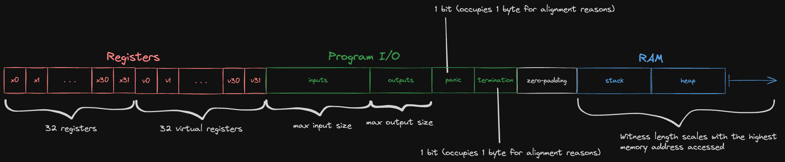
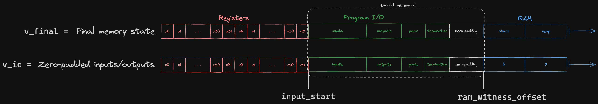

# RAM

Jolt proves the correctness of RAM operations using the [Twist](../twist-shout.md) memory checking algorithm, specifically utilizing the "local" prover algorithm.

## Dynamic parameters

In Twist, the parameter $K$ determines the size of the memory. For RAM, unlike registers, $K$ is not known a priori and depends on the memory usage of the guest program.
Consequently, the parameter $d$, dictating how the memory address space is partitioned into chunks, must also be dynamically tuned.
This ensures that no committed polynomial exceeds a maximum size defined by $T \times K^{1/d}$.

Jolt is currently configured so that $K^{1/d} = 2^4$ if $T < 2^{25}$ and $K^{1/d} = 2^8$ otherwise. Using smaller $K^{1/d}$ gives better prover performance for shorter trace lengths.

## Address remapping

We treat each 8-byte-aligned doubleword in the guest memory as one "cell" for the purposes of memory checking.
Our RISC-V [emulator](./emulation.md) is configured to use `0x80000000` as the DRAM start address -- the stack and heap occupy addresses above the start address, while Jolt reserves some memory below the start address for program inputs and outputs.



For the purposes of the memory checking argument, we remap the memory address to a witness index:

```rust
(address - memory_layout.lowest_address) / 8
```

where `lowest_address` is the left-most address depicted in the diagram above.
The division by eight reflects the fact that we treat guest memory as "doubleword-addressable" for the purposes of memory-checking.

Layout admission requires `heap_end <= 2^64 - 8` and
`lowest_address + 8 * max_ram_K <= 2^64`, where `max_ram_K` is the maximum
admitted power-of-two-padded RAM domain, not the domain selected by one proof.
Checked layout construction, full and committed preprocessing admission, and
verifier-key deserialization enforce these bounds before execution or verification.
The ELF decoder also rejects odd instruction addresses, matching bytecode admission's
two-byte alignment requirement. These checks add no per-cycle proof relation.

### Sub-doubleword accesses

Load and store instructions that access less than a full doubleword (e.g. `LB`, `SH`, `LW`) are expanded into [inline sequences](./emulation.md#virtual-instructions-and-sequences) around a *floor-addressed* doubleword access: `VirtualLoad{B,H,W}` reads, and `VirtualStore{B,H,W}` writes, the doubleword containing the effective address `ea = rs1 + imm`.
A sub-word load takes three cycles (the doubleword load, a lane mask, and a parallel extract), and a sub-word store six (a read-modify-write of the containing doubleword).

A floor-addressed row carries the intra-doubleword offset in its lookup slot, which a memory row otherwise leaves unused: its `AddressOffset{B,H,W}` table returns `ea & 7`, `ea & 6` or `ea & 4`, keeping only the offset bits its access width allows.
The R1CS constraint for memory rows subtracts the lookup output:

$$
\textsf{RamAddress} = \textsf{Rs1Value} + \textsf{Imm} - \textsf{LookupOutput}
$$

`LD` and `SD` look up no table, so their lookup output is 0 and `RamAddress` is the effective address.
For a floor-addressed row, `RamAddress` is the address of the doubleword it accesses.

RAF evaluation ties `RamAddress` to the one-hot address: on each cycle it must equal $8k + \texttt{lowest\_address}$ for the accessed cell $k$, or 0 on a cycle without a RAM access.
The verifier requires `lowest_address` to be a multiple of 8, so every admissible `RamAddress` is a multiple of 8.
An access misaligned for its width, such as an `LH` at an odd address or any misaligned `LD`, leaves a low bit set in `RamAddress` and cannot be proven.

## Read-write checking and protected words

RAM read-write checking enforces value consistency, address selection, value
preservation on protected words and the exclusion of unmapped words.
Let $E(j)=\widetilde{\textsf{eq}}(r_0,j)$, where $r_0$ is the outer sumcheck's
cycle point, and let $C(k)$ select words containing real source instructions,
program input, trusted advice, untrusted advice or the stack canary
`[stack_end, stack_end + STACK_CANARY_SIZE)`.
Let $N(k)$ select the unmapped words of the proof's domain: the padding
`[io_end, RAM_START_ADDRESS)` between the I/O region and DRAM, and the words
from `heap_end` to `lowest_address + 8K`.
Stage 2 proves

$$
\textsf{Read}(r_0)+\gamma\textsf{Write}(r_0)
 +\gamma^3(\textsf{Load}+\textsf{Store})(r_0)
 =\sum_{k,j}E(j)\textsf{ra}(k,j)
 \left[(1+\gamma)\textsf{Val}(k,j)
 +(\gamma+\gamma^2 C(k))\textsf{Inc}(j)+\gamma^3+\gamma^4 N(k)\right].
$$

The $\gamma^2$ identity forces zero increments on protected words. It rejects
changes to any of these regions even when a later store restores the original
value. Same-value stores remain valid, including byte, halfword and word stores
into a protected
doubleword. The $\gamma^3$ identity ties the selector sum to the existing Load
and Store flags. Together with Booleanity of every committed RAM chunk, it
requires one selected address on memory rows and none on other rows. It is the
only RAM one-hotness check (see [No-op cycles](#no-op-cycles)). Virtual memory
rows and the field-inline memory accumulator carry these same flags.
The $\gamma^4$ identity, $0=\sum_{k,j}E(j)N(k)\textsf{ra}(k,j)$, forbids
selecting an unmapped word on any row. With `ra` zero-or-one-hot on each
cycle (the $\gamma^3$ identity with Booleanity), each cycle's count
$v(j)=\sum_k N(k)\textsf{ra}(k,j)$ is 0 or 1 and is fixed before $r_0$ is
drawn. The sum equals $\widetilde{v}(r_0)$, which vanishes at a random $r_0$
only if every count is zero, that is, no cycle selects an unmapped word,
except with probability $\log T/|\mathbb{F}|$. Layout construction rounds
`heap_end` up to a doubleword, matching the linker's aligned `__heap_end`, and
admission rejects an unaligned `heap_end`, so a guest that uses the whole heap
never touches a word in $N$. The panic and termination words lie below
`io_end` and are outside $N$.

Preprocessing rounds each real source instruction's two- or four-byte extent
outward to doublewords, merges adjacent intervals and excludes synthetic
address-zero padding and intermediate virtual rows. It combines these intervals
with the input, advice and canary extents from the public memory layout,
rounds them outward to doublewords and merges overlaps and neighbors. $C$
uses RAM indices relative to the lowest mapped address, including I/O below
DRAM and index zero, and restricts the union to the proof's RAM domain. Both
the source intervals and the memory layout enter the program digest in both
full and committed program modes. Full preprocessing
checks exact source coverage; committed verification trusts the authenticated
key's coverage and checks the public interval shape and bounds. ELF admission
rejects writable sections sharing a protected word. Read-only data sharing a
code word is frozen with that word; text padding alone does not protect a word.

At the final opening point, the verifier evaluates the multilinear extensions
of both masks, rather than testing membership at a field-valued address. For
$s$ intervals this takes $O(s\log K)$ arithmetic; $N$ has at most two
intervals. The optimized prover uses
interval endpoints and at most two boundary weights per interval while binding
address bits. It adds no dense mask, trace pass, commitment, opening point or
sumcheck round; the maximum degree remains three.

The RAM value check reconstructs each pre-access value from initial RAM and
all earlier selected increments. Since the protection identity makes those
increments zero on protected words, each protected value equals its initial
value throughout execution. Equality of initial and final RAM alone would permit
a temporary modification.

The interpreter, replay tracer and native tracer reject a changed protected
word before writing it, reject loads below `lowest_address`, and reject any
access at or above `io_end` below DRAM or at or above `heap_end` in DRAM. The
constraints reject the same accesses: the $\gamma^2$ identity rejects the
store, the $\gamma^3$ identity with RAF evaluation rejects any address outside
the proof's domain `[lowest_address, lowest_address + 8K)`, and the
$\gamma^4$ identity rejects any access to a word in $N$. The rest of the tracer's store-permission policy has no
matching constraint. Host calls (prints, cycle
markers and advice writes) never stop the run: a call whose buffer has a byte
below `lowest_address`, or any other byte a guest load would reject, is logged
and ignored.

## Deviations from the Twist algorithm as described in the paper

Our implementation of the Twist prover algorithm differs from the description given in the Twist and Shout [paper](https://eprint.iacr.org/2025/105) in a couple of ways. One such deviation is [wv virtualization](../twist-shout.md#wv-virtualization). Other, RAM-specific deviations are described below.

### Single operation per cycle

The Twist algorithm as described in the paper assumes one read and one write per cycle, with corresponding polynomials $\widetilde{\textsf{ra}}$ (read address) and $\widetilde{\textsf{wa}}$ (write address).
However, in the context of the RV64IMAC instruction set, only a single memory operation -- either a read or a write (or neither) -- is performed per cycle.
Thus, a single polynomial (merging $\widetilde{\textsf{ra}}$ and $\widetilde{\textsf{wa}}$) suffices, simplifying and optimizing the algorithm.
This polynomial is referred to as $\widetilde{\textsf{ra}}$ for the rest of this document.

### No-op cycles

Many instructions do not access memory, so we represent them using a row of zeros in the $\widetilde{\textsf{ra}}$ polynomial rather than the one-hot encoding of the accessed address.
Having more zeros in $\widetilde{\textsf{ra}}$ makes it cheaper to commit to and speeds up some of the other Twist sumchecks.
The paper's [Hamming weight](../twist-shout.md#one-hot-polynomials) check, which requires every row of $\widetilde{\textsf{ra}}$ to have weight 1, therefore does not apply to RAM.
Instead, the $\gamma^3$ identity of [read-write checking](#read-write-checking-and-protected-words) requires, on every cycle $j$,

$$
\sum_{k} \textsf{ra}(k, j) = \textsf{Load}(j) + \textsf{Store}(j).
$$

No instruction sets both flags (the `load_store_exclusive` test in `jolt-riscv` pins the instruction catalog, and bytecode read-checking ties each cycle's flags to its bytecode row), so the right-hand side is 0 or 1.
The $d$ committed chunks factor the selector as $\textsf{ra}(k, j) = \prod_{i=1}^{d} \textsf{ra}_i(k_i, j)$ (as described [above](#dynamic-parameters), $d$ for RAM is dynamic), so the left-hand side is $\prod_{i=1}^{d} n_i(j)$, where $n_i(j) = \sum_{k_i} \textsf{ra}_i(k_i, j)$ sums over the values that digit $k_i$ takes in addresses of the RAM domain.
Booleanity of every committed chunk makes each $n_i(j)$ a nonnegative integer, and the product is far below the field modulus, so the equation holds over the integers.
On a memory row the product is 1, so every chunk's row is one-hot and $\textsf{ra}$ selects exactly one word.
On any other row the product is 0, so some chunk's row is zero and $\textsf{ra}$ selects no word.
Individual chunk weights are not otherwise constrained: on a non-memory row, the chunks other than a zero one may hold several ones.

### ra virtualization

In Twist as described in the paper, a higher $d$ parameter would translate to higher sumcheck degree for the read checking, write checking, and $\widetilde{\textsf{raf}}$ evaluation sumchecks.
Moreover, $d > 1$ is fundamentally incompatible with the [local](../twist-shout.md#local-vs-alternative-algorithm) prover algorithm for the read/write checking sumchecks.

To leverage the local algorithm while still supporting $d > 1$, Jolt simply carries out the read checking, write checking, and $\widetilde{\textsf{raf}}$ evaluation sumchecks *as if* $d = 1$, i.e. with a single (virtual) $\widetilde{\textsf{ra}}$ polynomial.

At the conclusion of these sumchecks, we are left with claims about the virtual $\widetilde{\textsf{ra}}$ polynomial.
Since the polynomial is uncommitted, Jolt invokes a separate sumcheck that expresses an evaluation $\widetilde{\textsf{ra}}$ in terms of the constituent $\widetilde{\textsf{ra}}_i$ polynomials.
The $\widetilde{\textsf{ra}}_i$ polynomials are, by definition, a tensor decomposition of $\widetilde{\textsf{ra}}$, so the "ra virtualization" sumcheck is the following:

$$
\widetilde{\textsf{ra}}(r, r') = \sum_{j \in \{0, 1\}^{\log(T)}} \widetilde{\textsf{eq}}(r', j) \cdot \left( \prod_{i=1}^d \widetilde{\textsf{ra}}_i(r_i, j) \right)
$$

### Advice Inputs

The $\widetilde{\textsf{Val}}$ evaluation sumcheck in Twist requires both the prover and verifier to know the initial state of the lookup table.
When advice inputs are present in the RAM lookup table, the verifier doesn't have direct access to these values.
To address this, the prover provides evaluations of the advice inputs and later proves their correctness against commitments held by the verifier.

For trusted advice, the commitment is generated externally; for untrusted advice, the prover generates the commitment.
All advice inputs are placed at the lowest addresses of the RAM lookup table, with the larger advice type placed first to minimize field multiplications during verification.

We represent advice inputs and the RAM lookup table as multi-linear polynomials, assuming their sizes are powers of two.

Let:
- $\widetilde{\textsf{ram}}_{\text{init-p}}(k)$ be the prover's RAM lookup table polynomial (including advice)
- $\widetilde{\textsf{ram}}_{\text{init-v}}(k)$ be the verifier's RAM lookup table polynomial (zeros in advice section, otherwise identical to prover's)
- $\widetilde{\textsf{trusted}}(m)$ be the trusted advice polynomial
- $\widetilde{\textsf{untrusted}}(n)$ be the untrusted advice polynomial

where $m \geq n$ (if this condition isn't met, we reorder the advice types to ensure the larger one comes first).

Let $i$ be the position of the single set bit in $(m + n) / m$ within its $\log k$-bit representation.
This position corresponds to bit $\log m$ when $n < m$, or $\log m + 1$ when $n = m$.

The relationship between these polynomials is:

$$
\widetilde{\textsf{ram}}_{\text{init-p}}(k) = \widetilde{\textsf{ram}}_{\text{init-v}}(k) + \left( \prod_{j=0}^{\log k - \log m - 1}(1-k_j) \right) \cdot \widetilde{\textsf{trusted}}(k_{\log k - \log m} , \dots, k_{(\log k) - 1})  + \left( \prod_{j=0, j \neq i}^{\log k - \log n - 1}(1-k_j) \right) \cdot k_i \cdot \widetilde{\textsf{untrusted}}(k_{\log k - \log n}, \dots, k_{(\log n)-1})
$$

Since the verifier only needs to evaluate $\widetilde{\textsf{ram}}_{\text{init-p}}$ at a random point, it can compute this value efficiently using $\widetilde{\textsf{ram}}_{\text{init-v}}$ and the evaluations of the trusted and untrusted components.

#### Example

Consider a concrete example with:
- Total memory: 8192 elements ($2^{13}$)
- Trusted advice: 1024 elements ($2^{10}$)
- Untrusted advice: 128 elements ($2^7$)

The memory layout would be:
- Addresses with the 3 MSBs as `000`: trusted advice region (all combinations of the remaining 10 bits)
- Addresses with the MSBs as `001000`: untrusted advice region (all combinations of the remaining 7 LSBs)

This arrangement minimizes verifier computation. If we placed untrusted advice first, the verifier would need to check multiple bit patterns (`000001`, `000010`, etc.) for the trusted section, resulting in significantly more field multiplications.


## Output Check

Jolt ensures correctness of guest program outputs via the **output check** sumcheck.
Guest I/O operations, including outputs, inputs, and termination or panic bits, occur within a designated [memory region](#address-remapping).
At execution completion, outputs and relevant status bits are written into this region.

Verifying that the claimed outputs and status bits are correct amounts to checking that the following polynomials agree at the indices corresponding to the program I/O memory region:



Note that `val_io` is only contains information known by the verifier.
To check that these two polynomials are equal, we use the following sumcheck:

$$
0 = \sum_{k \in \{0, 1\}^{\log K}} \widetilde{\textsf{eq}}(r_\text{address}, k) \cdot \widetilde{\textsf{io-range}}(k) \cdot \left( \widetilde{\textsf{Val}}_\text{final}(k) - \widetilde{\textsf{Val}}_\text{io}(k) \right)
$$

where $\widetilde{\textsf{io-range}}$ is a "range mask" polynomial, equal to 1 at all the indices corresponding to the program I/O region and 0 elsewhere.
The MLE for a range mask polynomial that isolates the range $[\text{start}, \text{end})$ can be written as follows:

$$
\widetilde{\textsf{mask}}_\text{start, end}(r) = \widetilde{\textsf{LT}}(r, \text{end}) - \widetilde{\textsf{LT}}(r, \text{start})
$$

It is implemented in code as `RangeMaskPolynomial`.

This output check sumcheck generates a claim about the final memory state polynomial ($\widetilde{\textsf{Val}}_\text{final}$), which, being virtual, is proven using the $\widetilde{\textsf{Val}}_\text{final}$ evaluation sumcheck:

$$
\widetilde{\textsf{Val}}_\text{final}(r) - \widetilde{\textsf{Val}}_\text{init}(r) = \sum_{j \in \{0, 1\}^{\log(T)}} \widetilde{\textsf{Inc}}(j) \cdot \widetilde{\textsf{ra}}(r, j)
$$

Intuitively, the delta between the final and initial state of some memory cell is the sum of all increments to that cell.

The verifier also requires evaluations of the advice sections to compute $\widetilde{\textsf{Val}}_\text{init}$.
As with the $\widetilde{\textsf{Val}}$ evaluation described above, the prover provides these evaluations.
Since both sumchecks use the same randomness, the prover only needs to provide one evaluation proof per advice type.
If different randomness were used, separate proofs would be required for each sumcheck.

You may have noticed in the above expression that $\widetilde{\textsf{Inc}}(j)$ if a polynomial only over cyclce variables, while the book describes $\widetilde{\textsf{Inc}}: \mathbb{F}^{\log K} \times \mathbb{F}^{\log T} \rightarrow \mathbb{F}$.
This change is explained in [wv virtualization](../twist-shout.md#wv-virtualization).

Both the $\widetilde{\textsf{Val}}_\text{final}$ and $\widetilde{\textsf{Val}}$ evaluation sumchecks use the virtual $\widetilde{\textsf{ra}}$ polynomial, with claims subsequently proven via [ra virtualization](#ra-virtualization) sumcheck.
